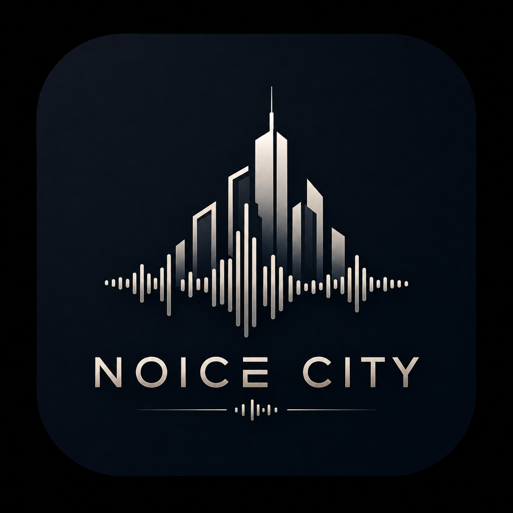

<div align="center">
  
  <h1>Noice City</h1>
  <p><strong>macOS DMG — coming soon</strong></p>
  <p><a href="LICENSE">Apache License 2.0</a> · <a href="TRADEMARKS.md">Brand policy</a></p>
  <p>A signed and notarized Apple Silicon installer is being prepared.<br>
  There is no public download yet; until it is released, use the source setup below.</p>
</div>

Noice City creates persistent personal voice variants from the installed
Qwen3-TTS 1.7B Base model on Apple Silicon. Home, Work, Narration, or any other
variant shares the immutable base weights while keeping its recordings, frozen
datasets, LoRA adapter, speaker embedding, evaluations, and promoted checkpoint
independent. Inference loads one variant artifact, installs its embedding in
slot `3000`, switches Qwen to `custom_voice`, and generates from text with no
reference recording.

All private state is stored under:

```text
~/Library/Application Support/VoiceTrainer
```

This legacy internal path is intentionally preserved after the Noice City
rename so existing recordings, datasets, models, and checkpoints remain linked.

Noice City does not import recordings, transcripts, prompt caches, profiles,
or environments from other voice applications. A first-run setup screen installs
only the pinned Qwen Base BF16 and Whisper snapshots.

Project policies: [Privacy](PRIVACY.md) · [Security](SECURITY.md) ·
[Contributing](CONTRIBUTING.md) · [Code of Conduct](CODE_OF_CONDUCT.md) ·
[License](LICENSE) · [Notice](NOTICE) ·
[Brand and trademarks](TRADEMARKS.md) ·
[Third-party notices](THIRD_PARTY_NOTICES.md) · [Model notices](MODEL_NOTICES.md)

## Prerequisites

- An Apple Silicon Mac running macOS 26.2 or newer for the current pinned MLX build
- Python 3.12
- [`uv`](https://docs.astral.sh/uv/)

## One-time setup

```bash
cd noice-city
./setup.sh
```

This creates the locked development environment. Start Noice City, then use
the explicit first-run screen to download approximately 6 GB of pinned Qwen and
Whisper weights. The downloader runs in its own setup process, verifies and
hashes every installed file, and atomically stores the models in private
Application Support storage. If the exact Qwen snapshot is already in the local
Hugging Face cache, setup adopts it without downloading it again.

Locked ML stack:

- Python 3.12
- MLX 0.32.0
- MLX-LM 0.31.3
- MLX-Audio 0.4.5

## Start offline

```bash
./start.sh
```

Ordinary startup never installs, resolves packages, or contacts a repository.
It binds only to `http://127.0.0.1:8787`, creates or reuses a private session
secret stored in Application Support, and opens the private browser UI. On a
fresh Mac, network access begins only after the user presses **Download model
pack**; the API process and all later recording, training, and generation
workers remain offline. API writes require both the session secret and the exact
loopback Origin.

## Tests

```bash
.venv/bin/python -m pytest
```

## Workflow

1. Choose or create a **Voice variant**. Every recording session is pinned to
   that stable lineage, and the selector scopes Record, Review, Train, and
   Generate. Variant display names may be changed without changing ownership.
2. **Record** starts with the recommended automatic mix: 80% guided reading,
   20% interview answers, 90% neutral, and 10% mild expression. Prompts are
   assigned to 80% train, 10% validation, and 10% locked test before capture.
3. Masters are immutable 48 kHz mono PCM24 WAV. Noice City creates immutable
   24 kHz mono PCM16 training derivatives and runs local signal/VAD-style QA and
   local Whisper transcription. Uncertain takes require complete playback and
   explicit transcript confirmation.
4. After two approved minutes from the built-in Recommended mix, **My script**
   unlocks for that voice variant. Paste up to 20,000 characters and the app
   creates short, resumable recording takes. These are supplemental guided,
   neutral training items; validation/test and coverage gates continue to use
   the preassigned catalog prompts.
5. At two accepted minutes, freeze a pilot dataset and train one pilot
   checkpoint. At thirty accepted minutes, freeze a full dataset; sixty minutes
   is recommended. Training always reads a checksummed frozen manifest, never
   the live recording collection.
6. Training runs in a separate offline process and exits after saving its
   artifacts. A different fresh process reloads each checkpoint and generates
   the twenty locked narration tests without reference audio.
7. Local evaluation measures Whisper WER, Qwen ECAPA speaker similarity against
   held-out real test takes, repetition, silence, termination, and duration.
   Complete the hidden A/B listening review in **Train**. A checkpoint is
   promoted only when all objective gates pass and it wins at least 12/20
   comparisons. Failed candidates and the prior promoted version are retained.
8. **Generate** accepts text, a delivery preset, a checkpoint version, and an
   optional integer seed (`0`–`4294967295`) for reproducible sampling. Omitting
   the seed preserves stochastic generation. The API has no reference-audio
   field.

The pilot and thirty-minute gates apply independently to every variant. Full
training is blocked until that same variant has a promoted pilot. Full runs use
batch size 1, gradient accumulation 4, gradient checkpointing, learning rate
`1e-5`, seed `3407`, and preserve all three epochs. Checkpoint promotion and A/B
comparison are also isolated per variant.

## Local API

The primary routes are:

```text
GET    /api/status
GET    /api/model-setup
POST   /api/model-setup
GET    /api/variants
POST   /api/variants
PATCH  /api/variants/{id}
POST   /api/recording-sessions
POST   /api/custom-scripts
GET    /api/custom-scripts/next
GET    /api/prompts/next
POST   /api/recordings
PATCH  /api/recordings/{id}
POST   /api/datasets/freeze
POST   /api/training-runs
GET    /api/training-runs/{id}
DELETE /api/training-runs/{id}
POST   /api/generations
```

Checkpoint evaluation, protected A/B audio, votes, and retries are also exposed
under `/api/checkpoints/{id}/...` for the local UI.

## macOS app and DMG

**Release status: coming soon.** The first public DMG will be published only
after its Developer ID signature, Apple notarization ticket, clean-Mac install,
third-party/model notices, and published checksum have been verified. The
current package target is Apple Silicon on macOS 26.2 or newer.

The release scaffold in [`packaging/macos`](packaging/macos/README.md) builds an
Apple Silicon `.app`, signs its nested runtime, creates a drag-to-Applications
DMG, and provides notarization and Gatekeeper verification steps. The bundle
uses an allowlist and never includes `.venv`, model weights, recordings,
datasets, adapters, generated audio, SQLite state, or session tokens.

## Privacy and responsible use

Record or adapt only your own voice, or a voice you have explicit permission to
use. Do not use Noice City to impersonate someone, bypass consent, or mislead an
audience about who is speaking. Voice recordings and trained artifacts are
sensitive biometric-like data; keep Application Support backups private.

Noice City has no cloud speech backend, accounts, analytics, advertising, or
automatic upload path. The one-time model installer contacts Hugging Face only
after an explicit click. Recording, review, training, evaluation, and generation
then run locally. See [PRIVACY.md](PRIVACY.md) for the complete data and network
boundary.

## License

Noice City is open source under the [Apache License 2.0](LICENSE). Third-party
software and model snapshots remain subject to their respective terms; see the
[third-party notices](THIRD_PARTY_NOTICES.md) and [model notices](MODEL_NOTICES.md).
Project attribution is recorded in [NOTICE](NOTICE). The Apache license does not
grant permission to use project trademarks; see the [trademark and brand
policy](TRADEMARKS.md) for the limited permitted uses and fork requirements.

## What exists before recording

The application, training objective, offline workers, evaluation protocol, and
generation runtime are implemented and locally verified. The repository never
contains a real voice adapter or recording; those are created from fresh local
voice data and remain in Application Support. The two-minute pilot is an
intentional quality gate: if it is not recognizably the target speaker, the
objective should be corrected before collecting or training the full set.
